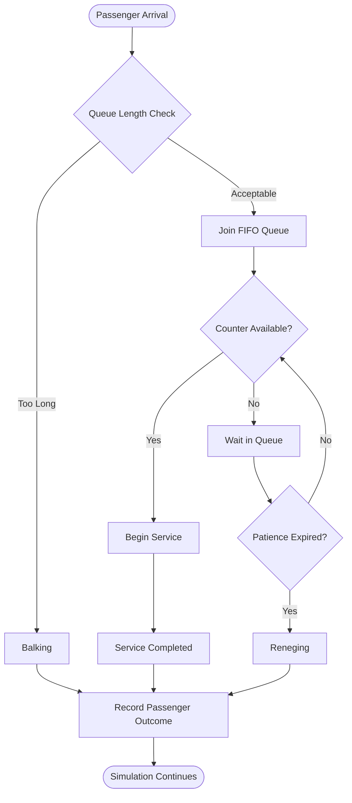

# RAILOVA
### Railway Operations & Virtual Analytics

**Simulating Passenger Flow. Analysing Queues. Understanding Railway Operations.**

RAILOVA is a railway ticket-counter simulation and analytics platform built around **M/M/c queuing theory**. It models passenger arrivals, queue formation, counter service, balking, and reneging to analyse service efficiency under different operating conditions.

The platform combines discrete-event simulation with interactive visualisation and performance analytics to help understand how passenger flow and counter capacity influence waiting times and queue behaviour.

---

## Project Overview

RAILOVA simulates a railway ticket-counter environment with multiple parallel service counters. Passengers arrive, join a FIFO queue, receive service, or leave depending on queue conditions and patience limits.

The simulation evaluates three operational scenarios:

| Scenario | Arrival Rate (λ) | Service Rate (μ) | Counters |
|---|---:|---:|---:|
| Normal | 0.60 passengers/min | 0.30 passengers/min | 3 |
| Peak Hour | 0.80 passengers/min | 0.30 passengers/min | 3 |
| Overloaded | 1.00 passengers/min | 0.30 passengers/min | 3 |

## Core Features

- **Multi-counter simulation:** Models multiple ticket counters operating in parallel.
- **FIFO queue management:** Passengers are served in First-In, First-Out order.
- **Balking:** Models passengers deciding not to join an excessively long queue.
- **Reneging:** Simulates passengers leaving after waiting beyond their patience limit.
- **Scenario analysis:** Compares normal, peak-hour, and overloaded conditions.
- **Performance analytics:** Evaluates waiting times, queue lengths, counter utilisation, and passenger outcomes.
- **Data visualisation:** Presents simulation results through graphical analysis.
- **CSV export:** Supports downloading simulation data for further analysis.

## How the Simulation Works



## Mathematical Model

RAILOVA uses the **M/M/c queuing model**, where:

- **M:** Passenger arrivals follow a Poisson process, with exponentially distributed inter-arrival times.
- **M:** Service times follow an exponential distribution.
- **c:** Multiple parallel service counters operate simultaneously.

### Traffic Intensity

Traffic intensity indicates how heavily the counters are utilised relative to incoming demand.

\[
\rho = \frac{\lambda}{c\mu}
\]

Where:

- λ = Average passenger arrival rate
- μ = Average service rate per counter
- c = Number of service counters

For a stable conventional M/M/c queue, traffic intensity must be less than 1.

### Passenger Behaviour

**1. Balking**

A passenger may decide not to enter the queue when the queue becomes too long. RAILOVA uses a queue threshold and a maximum threshold to determine the probability of balking.

**2. Reneging**

A passenger who has joined the queue may leave if their waiting time exceeds their patience limit.

**3. FIFO Service**

Passengers who remain in the queue are served in the order in which they arrive.

## Operational Scenarios

RAILOVA evaluates different demand conditions to understand the impact of passenger arrivals on counter performance.

| Scenario | Arrival Rate | Traffic Intensity |
|---|---:|---:|
| Normal | 0.60/min | 66.67% |
| Peak Hour | 0.80/min | 88.89% |
| Overloaded | 1.00/min | 111.11% |

*Traffic intensity is calculated using three counters, each with a service rate of 0.30 passengers per minute.*

The overloaded scenario exceeds the conventional M/M/c stability condition, illustrating how demand can outpace available service capacity.

## Technology Stack

| Technology | Purpose |
|---|---|
| Python | Simulation logic and backend implementation |
| SimPy | Discrete-event simulation |
| NumPy | Numerical computations |
| Pandas | Data processing and analysis |
| Matplotlib | Data visualisation |
| Seaborn | Statistical visualisation |
| Streamlit | Browser-based Python application |
| HTML, CSS & JavaScript | Web-based interface |
| Chart.js | Interactive charts |

## Project Structure

```text
RAILOVA/
│
├── railway_ticket_simulation/
│   ├── index.html
│   ├── docs/
│   │   └── index.html
│   │
│   ├── streamlit_app.py
│   ├── config.py
│   ├── passenger.py
│   ├── counter.py
│   ├── simulation.py
│   ├── visualize.py
│   ├── main.py
│   ├── gui_sim.py
│   ├── test_simulation.py
│   │
│   ├── requirements.txt
│   └── outputs/
│
└── README.md
```

## Getting Started

### Prerequisites

- Python 3.10 or later
- pip package manager
- Git

### Installation

**1. Clone the repository**

```bash
git clone https://github.com/urvipandey08/RAILOVA.git
```

**2. Navigate to the project directory**

```bash
cd RAILOVA/railway_ticket_simulation
```

**3. Install dependencies**

```bash
pip install -r requirements.txt
```

**4. Launch the Streamlit application**

```bash
streamlit run streamlit_app.py
```

Follow the terminal output to open the application in your browser.

## Project Objectives

- Analyse passenger arrival and service patterns.
- Understand queue formation under varying traffic conditions.
- Study the effects of balking and reneging on passenger flow.
- Evaluate counter utilisation and service efficiency.
- Compare operational performance under different demand scenarios.
- Demonstrate the practical application of queuing theory through simulation.

## Future Scope

- Dynamic counter allocation based on passenger demand.
- More advanced passenger arrival and service patterns.
- Expanded operational scenarios.
- Additional performance indicators and comparative analytics.
- Improved simulation and reporting capabilities.

---

## Author

**Urvi Pandey**

Independent Project | Railway Operations & Simulation Analytics

[GitHub Profile](https://github.com/urvipandey08)

---

<p align="center">
  <b>RAILOVA</b><br>
  Railway Operations & Virtual Analytics<br>
  <i>Understanding queues. Improving service efficiency.</i>
</p>
