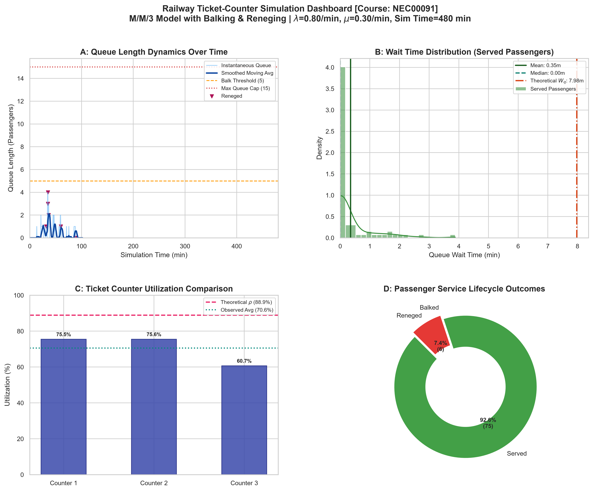
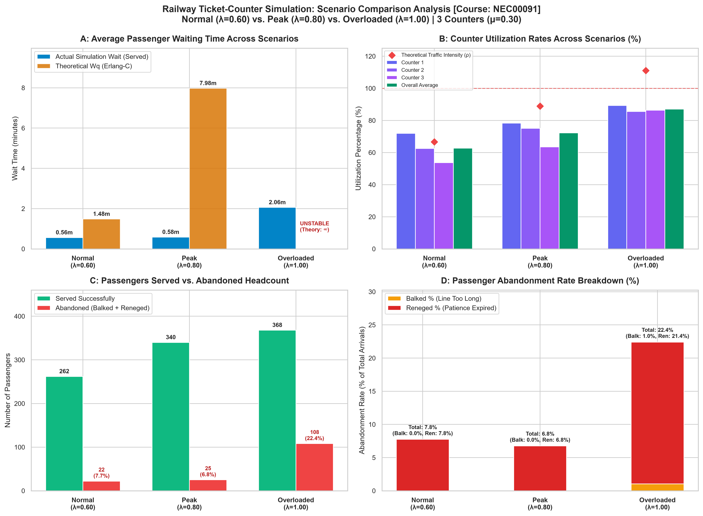

# Railway Ticket-Counter Simulation (M/M/c Queuing System)

**Course**: Solving Problems Using Modelling and Simulation  
**Course Code**: NEC00091  
**Framework**: Discrete-Event Simulation with [SimPy](https://simpy.readthedocs.io/), NumPy, Pandas, Matplotlib, and Seaborn.

---

## 1. Project Overview

This project provides a discrete-event simulation model of a multi-server Railway Ticket Booking Facility operating under the Kendall notation **M/M/c** queuing framework. The model incorporates behavioral extensions:
1. **Passenger Balking**: Arriving passengers evaluate the current queue size and may turn away without joining if the line is too long.
2. **Passenger Reneging**: Passengers who have joined the queue abandon their position without receiving service if their waiting time exceeds their personal patience threshold.

The simulation records timestamped event metrics into structured **Pandas DataFrames**, exports detailed CSV logs, and produces high-resolution analytical visualizations comparing empirical results with classical **Erlang-C** queueing theory.

---

## 2. Mathematical and Queueing Theory Formulation

### 2.1 Basic M/M/c System Properties
- **Arrival Process ($M$)**: Poisson arrival process with rate $\lambda$ (inter-arrival times $A \sim \text{Exponential}(\lambda)$).
- **Service Process ($M$)**: Identical exponential service times across counters with rate $\mu$ (mean service duration $= 1/\mu$).
- **Number of Servers ($c$)**: $c$ parallel ticket counters drawing from a single centralized FIFO queue.
- **Traffic Intensity ($\rho$)**:
  $$\rho = \frac{\lambda}{c \cdot \mu}$$
  For long-term stability in classical queues without balking/reneging, $\rho < 1.0$.

### 2.2 Analytical Erlang-C Formulation (Baseline Benchmark)
For an infinite-capacity $M/M/c$ queue without abandonment:
- **System Idle Probability ($P_0$)**:
  $$P_0 = \left[ \sum_{n=0}^{c-1} \frac{(\lambda / \mu)^n}{n!} + \frac{(\lambda / \mu)^c}{c! \left(1 - \rho\right)} \right]^{-1}$$

- **Probability of Queuing (Erlang-C Formula)**:
  $$P_Q = P(\text{Wait} > 0) = \frac{(\lambda / \mu)^c}{c! \left(1 - \rho\right)} \cdot P_0$$

- **Expected Queue Length ($L_q$) & Expected Wait Time in Queue ($W_q$)** (via Little's Law):
  $$L_q = \frac{P_Q \cdot \rho}{1 - \rho}, \quad W_q = \frac{L_q}{\lambda}, \quad W = W_q + \frac{1}{\mu}, \quad L = \lambda \cdot W$$

### 2.3 Behavioral Extensions

#### A. Balking Model
When an arriving passenger observes the instantaneous queue length $N_q$:
- If $N_q \le K_{\text{thresh}}$, $P(\text{Balk}) = 0$.
- If $N_q \ge K_{\text{max}}$, $P(\text{Balk}) = 1.0$.
- For $K_{\text{thresh}} < N_q < K_{\text{max}}$ (linear model):
  $$P(\text{Balk} \mid N_q) = \frac{N_q - K_{\text{thresh}}}{K_{\text{max}} - K_{\text{thresh}}}$$

#### B. Reneging Model
Upon entering the queue at time $t_{\text{enter}}$, a passenger is assigned a patience deadline $\tau \sim \text{Exponential}(\text{mean} = \tau_{\text{renege}})$.
The passenger waits for:
$$t_{\text{wait}} = \min(t_{\text{counter\_available}} - t_{\text{enter}}, \, \tau)$$
If $\tau < t_{\text{counter\_available}} - t_{\text{enter}}$, the passenger reneges, aborts the resource request, and leaves the station unserved.

---

## 3. Project Architecture

The codebase follows a modular design adhering to simulation software standards:

```
railway_ticket_simulation/
├── config.py              # Configuration dataclass, parameters, and theoretical Erlang-C solver
├── passenger.py           # Passenger entity, balking/reneging logic, SimPy process generator
├── counter.py             # TicketCounter and TicketCounterSystem resource management
├── simulation.py          # Discrete-event simulation coordinator, time-series monitor, DF logger
├── visualize.py           # Publication-quality plotting suite (queue dynamics, wait time, utilization)
├── main.py                # CLI interface, experiment runner, and academic summary reporter
├── gui_sim.py             # Live interactive Tkinter graphical simulation runner for lab demonstrations
├── test_simulation.py     # Unit and validation test suite
├── requirements.txt       # Project dependencies
└── outputs/               # Generated CSV event datasets and PNG figures
    ├── passenger_logs.csv
    ├── queue_time_series.csv
    ├── events_log.csv
    ├── counter_utilization.csv
    ├── queue_length_over_time.png
    ├── wait_time_distribution.png
    ├── counter_utilization.png
    ├── passenger_outcomes.png
    ├── railway_simulation_dashboard.png
    └── scenario_comparison.png
```

---

## 4. Environment Setup & Installation

### 4.1 Clone the Repository
```bash
git clone https://github.com/<your-username>/railway_ticket_simulation.git
cd railway_ticket_simulation
```

### 4.2 Virtual Environment Setup
Create and activate an isolated virtual environment:

**On Windows (PowerShell):**
```powershell
python -m venv .venv
.\.venv\Scripts\Activate.ps1
```

**On Windows (Command Prompt):**
```cmd
python -m venv .venv
.\.venv\Scripts\activate.bat
```

**On Linux/macOS:**
```bash
python3 -m venv .venv
source .venv/bin/activate

# On Ubuntu/Debian, install Tkinter if not present:
sudo apt-get install python3-tk
```

### 4.3 Installing Dependencies
```bash
pip install -r requirements.txt
```

---

## 5. Running the Simulation

### 5.1 Default Run (Standard 8-Hour Shift)
```bash
python main.py
```
Default parameters:
- Simulation horizon: $480.0\text{ minutes}$ ($8\text{ hours}$)
- Number of counters ($c$): $3$
- Arrival rate ($\lambda$): $0.60\text{ passengers/min}$ (Normal Scenario)
- Service rate ($\mu$): $0.30\text{ passengers/min/counter}$ (mean service time: $3.33\text{ min}$)
- Theoretical traffic intensity: $\rho = \lambda / (c \mu) = 0.60 / (3 \times 0.30) = 66.67\%$
- Balking: Enabled ($K_{\text{thresh}} = 5$, $K_{\text{max}} = 15$)
- Reneging: Enabled (mean patience $= 10.0\text{ min}$)

### 5.2 Simulation Scenarios & Comparative Analysis (CLI)
You can select any of the three course scenarios or run comparative analysis:
```bash
# 1. Normal Scenario (lambda = 0.60, rho = 66.7% - Stable)
python main.py --scenario normal

# 2. Peak Rush Hour Scenario (lambda = 0.80, rho = 88.9% - Stable, High Congestion)
python main.py --scenario peak

# 3. Overloaded Scenario (lambda = 1.00, rho = 111.1% - Unstable, Stabilized by Abandonment)
python main.py --scenario overloaded

# 4. Compare all 3 Scenarios side-by-side and generate scenario_comparison.png
python main.py --compare-scenarios
```

### 5.3 Live Interactive GUI Runner (Real-Time Lab Demonstration)
To launch the real-time graphical visualizer on screen during your lab demo or viva:
```bash
python gui_sim.py
```
**Interactive GUI Features:**
- **3 Live Ticket Counters**: Distinct booths showing `IDLE` (green) or `BUSY` (red) status, clerk activity, customers served, and live empirical utilization percentages.
- **Animated Passenger Queue**: Visual FIFO queue showing passengers (`P1`, `P2`, ...) waiting in line, color-coded by waiting urgency.
- **Balking & Reneging Visualization**: Clearly marked on-screen floor thresholds:
  - `⚠️ Balking Threshold (5+)`: Queue area where balking risk begins.
  - `⛔ Max Capacity (15)`: Queue area with 100% balking cutoff.
  - An overhead exit lane with live tags for departed balked and reneged passengers.
- **Digital HUD**: Real-time simulation clock (`Sim Time: XX.X min`), KPI cards for Arrivals, In-Queue, In-Service, Served %, Balked %, and System Utilization.
- **Interactive Controls**:
  - `Play / Pause` button (or press `Spacebar`).
  - `Speed Slider` (1x, 2x, 5x, 10x, 20x) with one-click preset buttons.
  - `⏭ Step (+0.5m)` button for discrete frame-by-frame viva explanations.
  - `⚡ Spawn Surge (+5)` button to demonstrate sudden queue buildup and balking on demand.
  - `📊 Export Dashboard Plots` button to save high-resolution publication charts on the fly.

---

## 6. Output Datasets and Metrics

### 6.1 Generated Pandas DataFrames (Exported as CSVs)
1. **`passenger_logs.csv`**: Record for every arriving passenger containing:
   - `passenger_id`, `arrival_time`, `status` (`SERVED`, `BALKED`, `RENEGED`, `IN_SERVICE`)
   - `queue_length_at_arrival`, `system_size_at_arrival`, `patience_time`
   - `queue_enter_time`, `service_start_time`, `service_end_time`, `departure_time`
   - `wait_time`, `service_duration`, `total_system_time`, `assigned_counter_id`
2. **`queue_time_series.csv`**: Periodic snapshots (every $0.5\text{ min}$) of instantaneous queue length, busy counters, idle counters, total passengers in system, and rolling moving averages.
3. **`events_log.csv`**: Discrete event log recording transitions (`BALK`, `QUEUE_ENTER`, `SERVICE_START`, `SERVICE_COMPLETE`, `RENEGE`).
4. **`counter_utilization.csv`**: Counter-level breakdown of passengers served, cumulative busy time, and utilization percentage.

### 6.2 Analytical Visualizations

| Visualization | Output Preview |
| :--- | :--- |
| **Comprehensive Simulation Dashboard**<br>Integrated 4-panel summary combining queue dynamics, wait-time histogram, counter utilization, and passenger outcomes. |  |
| **Multi-Scenario Comparison**<br>Side-by-side comparison across Normal ($\lambda=0.60$), Peak ($\lambda=0.80$), and Overloaded ($\lambda=1.00$) scenarios. |  |

#### Individual Generated Plots:
- **`queue_length_over_time.png`**: Instantaneous queue size with moving average, balking thresholds, and marked balk/renege events.
- **`wait_time_distribution.png`**: Histogram and KDE of queue wait times with empirical mean/median and theoretical Erlang-C $W_q$ indicator.
- **`counter_utilization.png`**: Per-counter workload balancing and throughput alongside theoretical traffic intensity $\rho$.
- **`passenger_outcomes.png`**: Donut chart and breakdown of served vs. balked vs. reneged passengers.

---

## 7. Running Tests

Execute the validation and verification test suite:
```bash
python -m unittest test_simulation.py
```
Tests verify Erlang-C mathematical calculations, balking decision boundaries, reneging timeouts, and deterministic seed reproducibility.

